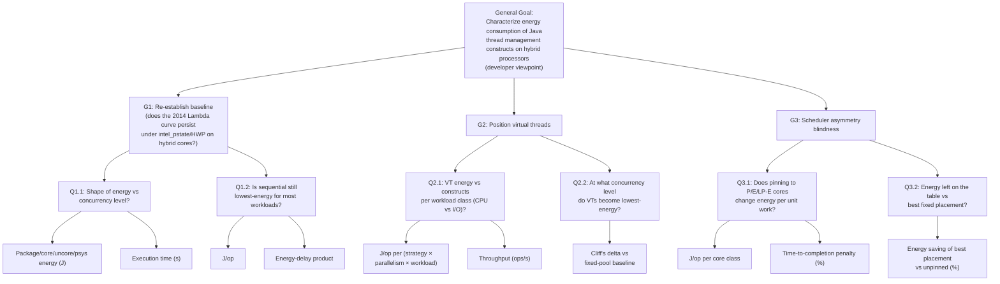

# Goal–Question–Metric (GQM) Tree

## General Goal (Basili template)

**Analyze** Java thread management constructs (platform threads, fixed thread pools, Fork-Join, and virtual threads)
**for the purpose of** characterizing
**with respect to** their energy consumption and its relationship to execution time
**from the point of view of** Java developers
**in the context of** hybrid processors combining performance, efficiency and low-power-efficiency cores.

## Specific Goals

### G1 — Re-establish the baseline

Does the 2014 "Lambda curve" (energy as a function of concurrency level) persist under modern `intel_pstate`/HWP frequency governance on hybrid cores?

| Question | Statement |
|---|---|
| Q1.1 | What is the shape of energy consumption versus concurrency level for each thread management construct? |
| Q1.2 | Is sequential execution still the lowest-energy option for most workloads? |

**Metrics (G1):**
- Package, core, uncore, and psys energy (J), via RAPL
- Execution time (s)
- Energy per operation (J/op)
- Energy-delay product (EDP)

### G2 — Position virtual threads

Where do virtual threads (JEP 444) sit in the energy landscape relative to classical constructs?

| Question | Statement |
|---|---|
| Q2.1 | How does virtual-thread energy consumption compare per workload class (CPU-bound vs I/O-bound)? |
| Q2.2 | At what concurrency level, if any, do virtual threads become the lowest-energy construct? |

**Metrics (G2):**
- J/op per (strategy × parallelism × workload) combination
- Throughput (ops/s)
- Cliff's delta effect size vs the fixed-pool baseline

### G3 — Scheduler asymmetry blindness

Does the OS/JVM scheduler's unawareness of core asymmetry cost energy on P/E/LP-E hybrid processors?

| Question | Statement |
|---|---|
| Q3.1 | Does pinning execution to P, E, or LP-E cores significantly change energy per unit of work? |
| Q3.2 | How much energy does the asymmetry-unaware scheduler leave on the table compared with the best fixed core placement? |

**Metrics (G3):**
- J/op per core class (P / E / LP-E)
- Time-to-completion penalty (%) per core class
- Energy saving of best fixed placement vs unpinned scheduling (%)

## GQM Tree

